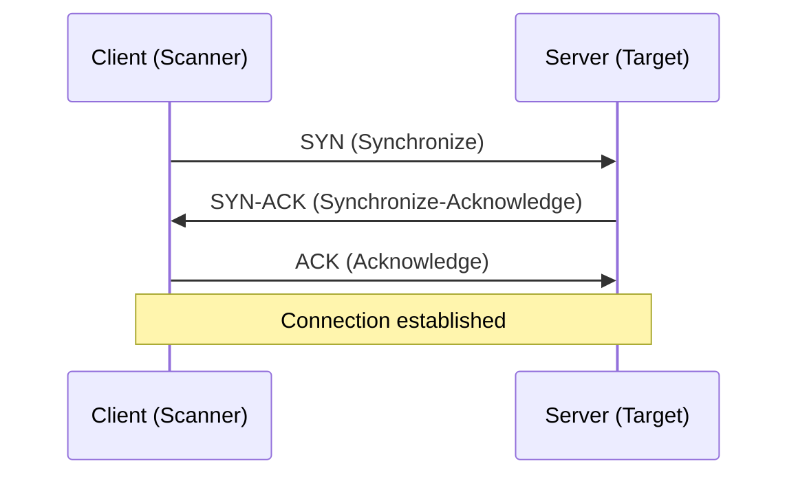
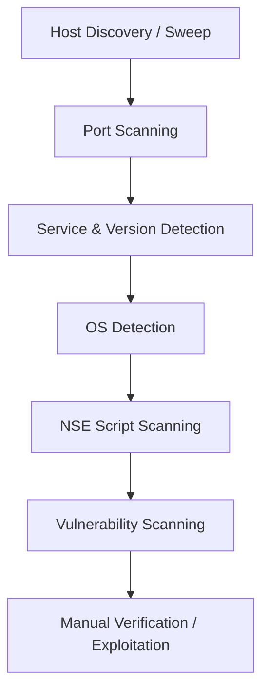
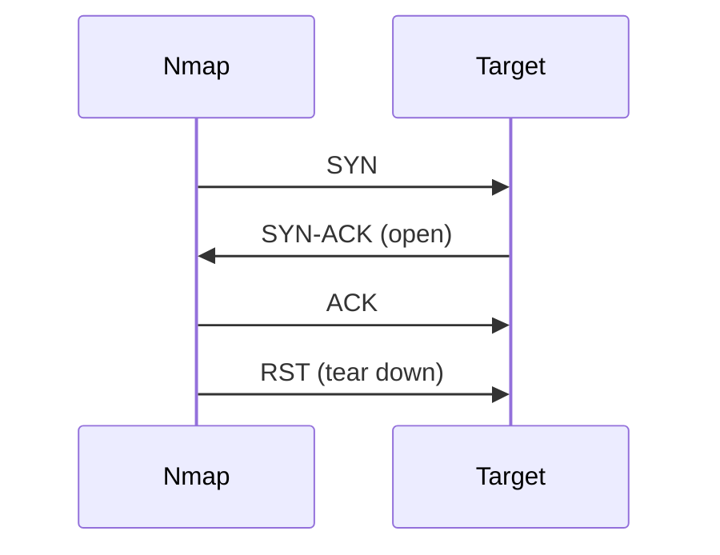
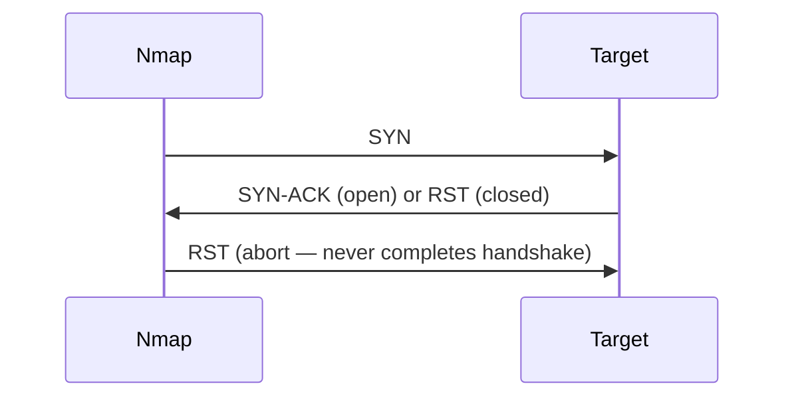
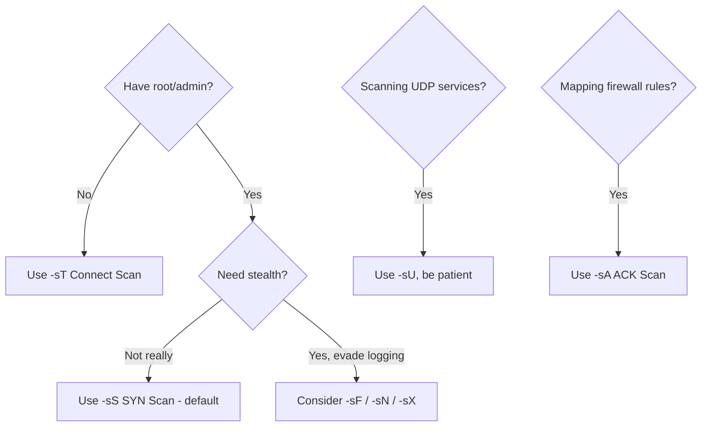

# NMAP

> **Portfolio focus:** A structured Nmap learning guide covering network discovery, service enumeration, and scan interpretation. Test only targets you own or are explicitly authorised to assess.

Nmap Mastery: From Packets to Practical Pentesting

# 🛰️ Nmap Mastery: From Packets to Practical Pentesting

> A hands-on Nmap tutorial for students — built to take you from "what's a socket?" to running real vulnerability scans with the Nmap Scripting Engine.

## 📖 About this guide

Nmap ("Network Mapper") is the tool almost every security professional reaches for first when they need to understand what's alive on a network, what it's running, and how exposed it is. This guide isn't just a list of flags to memorize — it's built so each section gives you the *why* before the *how*, because Nmap makes a lot more sense once you understand the networking concepts it's built on top of.

**How to use this guide:** Read it top to bottom the first time. After that, treat it as a reference — jump straight to the section you need with the table of contents below.

> ⚠️ **Ground rule:** Only scan systems you own or have explicit written permission to test. Unauthorized scanning can be illegal depending on your jurisdiction and the target's policies. Practice on your own lab (a home VM, a deliberately vulnerable box like Metasploitable, or platforms like TryHackMe/HackTheBox).

---

## 🗂️ Table of Contents

1. [Networking Foundations You Need First](#1-networking-foundations-you-need-first)
2. [Port States — What Nmap Is Actually Telling You](#2-port-states--what-nmap-is-actually-telling-you)
3. [The Nmap Scanning Workflow](#3-the-nmap-scanning-workflow)
4. [Target Specification](#4-target-specification)
5. [Host Discovery (Ping Sweeps)](#5-host-discovery-ping-sweeps)
6. [Scan Techniques](#6-scan-techniques)
7. [Port Specification and Scan Order](#7-port-specification-and-scan-order)
8. [Service, Version, and OS Detection](#8-service-version-and-os-detection)
9. [Timing and Performance](#9-timing-and-performance)
10. [Firewall / IDS Evasion and Spoofing](#10-firewall--ids-evasion-and-spoofing)
11. [Miscellaneous Useful Options](#11-miscellaneous-useful-options)
12. [The Nmap Scripting Engine (NSE)](#12-the-nmap-scripting-engine-nse)
13. [Vulnerability Scanning with Nmap](#13-vulnerability-scanning-with-nmap)
14. [Practical Lab Walkthrough](#14-practical-lab-walkthrough)
15. [Cheat Sheet](#15-cheat-sheet)
16. [References](#16-references)

---

## 1. Networking Foundations You Need First

Before touching Nmap, you need a mental model of what's actually happening on the wire. Everything Nmap reports is just an interpretation of how a target responds to crafted packets.

### 1.1 Sockets

A **socket** is the combination of an IP address and a port number (e.g. `192.168.1.10:443`). It's the addressable endpoint a program binds to in order to send or receive data. When Nmap "scans a port," it's really probing whether something is bound to a socket and listening.

### 1.2 TCP vs UDP

| | TCP | UDP |
|---|---|---|
| Connection type | Connection-oriented (handshake required) | Connectionless |
| Reliability | Guaranteed delivery, ordered | No guarantees |
| Speed | Slower (overhead) | Faster |
| Used by | HTTP(S), SSH, FTP, SMTP | DNS, DHCP, SNMP, NTP |
| Nmap scan flag | `-sS`, `-sT`, `-sA`, etc. | `-sU` |

This distinction matters a lot in Nmap because **TCP scanning is fast and reliable, while UDP scanning is slow and often ambiguous** — you'll see why once we cover port states.

### 1.3 The TCP Three-Way Handshake

TCP connections are established using three packets. This handshake is the foundation of the most common scan type (SYN scan), so understand it cold.



- **SYN** — "I'd like to start a connection."
- **SYN-ACK** — "Acknowledged, I'd like to as well."
- **ACK** — "Acknowledged. We're connected."

A normal TCP session then also has an orderly close (`FIN`/`ACK` exchange) or an abrupt one (`RST`).

### 1.4 The Flags That Matter to Nmap

| Flag | Meaning | Nmap relevance |
|---|---|---|
| `SYN` | Start connection | Used in SYN scan |
| `ACK` | Acknowledge receipt | Used in ACK scan (firewall mapping) |
| `SYN-ACK` | Accept connection | Indicates an **open** port |
| `RST` | Reset/refuse | Indicates a **closed** port |
| `FIN` | Politely close | Used in FIN scan (stealth) |
| `PSH`, `URG` | Push/urgent data | Used in Xmas scan combos |

### 1.5 Banner Grabbing

**Banner grabbing** is connecting to a service and reading the text it volunteers about itself — e.g. an FTP server announcing `vsftpd 3.0.3`. It's one of the oldest recon techniques and Nmap automates it as part of version detection (`-sV`).

```bash
# Manual banner grab with netcat, for comparison
nc -nv 192.168.1.10 21
```

---

## 2. Port States — What Nmap Is Actually Telling You

Nmap doesn't just say "open" or "closed." It has six possible states, and understanding each one tells you *why* Nmap concluded what it did.

| State | What it means | Typical cause |
|---|---|---|
| **open** | An application is actively accepting connections | A real service is listening |
| **closed** | Port is reachable but nothing is listening | Host is up, RST received |
| **filtered** | Nmap can't tell if it's open — no response, or an error | Firewall/ACL is dropping probes |
| **unfiltered** | Port is reachable but Nmap can't determine open/closed | Seen with ACK scan only |
| **open\|filtered** | Nmap can't decide between open and filtered | No response at all (common in UDP scans) |
| **closed\|filtered** | Nmap can't decide between closed and filtered | Rare; seen in idle scans |

**Rule of thumb:** the more "confused" states you see (`filtered`, `open|filtered`), the more likely there's a firewall or IDS shaping what reaches you — which sets up everything in Section 10.

---

## 3. The Nmap Scanning Workflow

Real-world Nmap usage tends to follow a funnel — wide and cheap first, narrow and expensive later:



- **Sweep:** "Which hosts on this network are even alive?"
- **Port scan:** "Which ports are open on the hosts that are alive?"
- **Fingerprinting/version scan:** "What software and version is behind each open port?"
- **OS detection:** "What operating system is this?"
- **Script scan / NSE:** "What extra intel or automated checks can I run?"
- **Vulnerability scan:** "Does any of this match a known CVE?"

Keep this funnel in your head — it's the order the rest of this guide follows, and it's the order you should actually work in during an engagement.

---

## 4. Target Specification

Nmap accepts targets in almost any format you'd want:

```bash
nmap 192.168.1.10                     # Single IP
nmap 192.168.1.10 192.168.1.15        # Multiple IPs
nmap 192.168.1.0/24                   # CIDR range
nmap 192.168.1.1-50                   # Range shorthand
nmap scanme.nmap.org                  # Hostname
nmap -iL targets.txt                  # From a file
nmap -iR 100                          # 100 random public hosts (use with caution/permission)
nmap 192.168.1.0/24 --exclude 192.168.1.1   # Exclude specific hosts
```

💡 **Tip:** `scanme.nmap.org` is a host the Nmap project explicitly leaves up for practice scanning — a safe, legal target while you're learning.

---

## 5. Host Discovery (Ping Sweeps)

Before scanning 65,535 ports on every possible address, it's cheaper to first find out who's home. This is the "sweep."

```bash
nmap -sn 192.168.1.0/24        # Ping sweep only, no port scan
nmap -PR 192.168.1.0/24        # ARP ping (fast, local network only)
nmap -PE 192.168.1.0/24        # ICMP echo ping
nmap -PS22,80,443 target       # TCP SYN ping to specific ports
nmap -PA80 target              # TCP ACK ping
nmap -PU target                # UDP ping
nmap -Pn target                # Skip discovery entirely — treat host as up
```

`-Pn` is important to remember: many hosts (and most CTF/lab boxes) block ICMP ping, so a normal scan will report them as "down" even though ports are open. `-Pn` forces Nmap to scan anyway.

---

## 6. Scan Techniques

This is the heart of Nmap — *how* it probes each port. Each technique trades off speed, stealth, and the permissions it needs.

### 6.1 TCP Connect Scan — `-sT`

Completes the **full three-way handshake** using the OS's normal networking stack. It's the only scan that doesn't need root/administrator privileges, but it's the noisiest — every attempt gets logged as a full connection.



### 6.2 TCP SYN Scan — `-sS` ("Half-open" / stealth scan)

The default and most popular scan. Sends a SYN, and if it gets a SYN-ACK back, immediately sends a **RST** instead of completing the handshake — the connection is never fully established, so many applications never log it.



Requires raw socket privileges (root/admin).

### 6.3 UDP Scan — `-sU`

Sends UDP packets and waits. Since UDP has no handshake:
- **Open:** a protocol-specific response comes back
- **Closed:** an ICMP "port unreachable" comes back
- **Open|filtered:** nothing comes back at all — the most common (and most ambiguous) result

This is why UDP scanning is much slower and less certain than TCP scanning.

### 6.4 FIN, Xmas, and Null Scans (Stealth trio)

These abuse a quirk in the TCP RFC: a closed port should respond with RST to an unexpected packet, but an open port should just ignore it. So *silence* implies open, and an RST implies closed.

| Scan | Flags sent | Flag | 
|---|---|---|
| FIN scan | `FIN` only | `-sF` |
| Xmas scan | `FIN`, `PSH`, `URG` ("lit up like a Christmas tree") | `-sX` |
| Null scan | No flags at all | `-sN` |

⚠️ These don't work reliably against Windows targets, which don't follow this part of the RFC — they'll show everything as closed regardless of real state.

### 6.5 ACK Scan — `-sA`

Doesn't determine open vs. closed at all — it's built to map **firewall rule sets**. If a RST comes back, the port is "unfiltered" (packet reached the host); if nothing comes back, it's "filtered" (something blocked it, likely a stateful firewall).

### 6.6 Other Notable Scans

```bash
nmap -sW target          # TCP Window scan — variant of ACK, examines window field
nmap -sM target          # TCP Maimon scan — FIN/ACK combo, exploits BSD-derived stack quirks
nmap -sZ target          # SCTP COOKIE ECHO scan
nmap -sY target          # SCTP INIT scan
nmap -sO target          # IP protocol scan — which IP protocols (TCP/UDP/ICMP/etc.) are supported
nmap -sI zombie_host target   # Idle/"zombie" scan — extremely stealthy, spoofs via a third host
```

### 6.7 Quick Decision Guide



---

## 7. Port Specification and Scan Order

By default, Nmap scans the 1,000 most common ports per protocol. You control this directly:

```bash
nmap -p 80 target                # Single port
nmap -p 22,80,443 target         # Specific list
nmap -p 1-1000 target            # Range
nmap -p- target                  # ALL 65535 ports
nmap -p U:53,T:21-25 target      # Mixed UDP/TCP
nmap -F target                   # Fast mode — top 100 ports only
nmap --top-ports 20 target       # Top N most common ports
nmap -r target                   # Scan ports in sequential order (not randomized)
```

By default Nmap **randomizes** the port scan order to be less predictable to intrusion detection systems — `-r` turns that off when you need deterministic, readable output (e.g. for a report).

---

## 8. Service, Version, and OS Detection

Once you know *which* ports are open, the next question is *what's* running on them.

### 8.1 Version Detection — `-sV`

Nmap doesn't just trust that port 80 is HTTP — it sends probes and compares responses against its `nmap-service-probes` database (banner grabbing, automated).

```bash
nmap -sV target
nmap -sV --version-intensity 9 target   # 0 (light) to 9 (try everything)
nmap -sV --version-light target         # Fast, fewer probes
```

### 8.2 OS Detection — `-O`

Nmap examines subtle quirks in how a target's TCP/IP stack behaves — initial TTL, TCP window size, options ordering, ISN generation — and matches the fingerprint against its OS database.

```bash
nmap -O target
nmap -O --osscan-guess target   # More aggressive guessing when results are ambiguous
```

> This isn't magic — it's a best-effort fingerprint match, and can be fooled or inconclusive, especially through NAT or a firewall.

### 8.3 The All-in-One Combo

```bash
nmap -A target
```

`-A` enables OS detection, version detection, script scanning (default set), and traceroute in one flag. Convenient for labs; noisy for real engagements — use deliberately, not as a reflex.

---

## 9. Timing and Performance

Nmap's timing controls balance **speed vs. accuracy vs. stealth**. Six built-in templates, from most paranoid to most aggressive:

| Template | Flag | Use case |
|---|---|---|
| Paranoid | `-T0` | Maximum stealth, extremely slow (IDS evasion) |
| Sneaky | `-T1` | Very slow, some stealth |
| Polite | `-T2` | Slower, less bandwidth/target load |
| Normal | `-T3` | Default behavior |
| Aggressive | `-T4` | Faster, assumes a reliable, unfiltered network |
| Insane | `-T5` | Fastest, sacrifices accuracy — easy to miss results |

```bash
nmap -T4 target                          # Most common choice for labs/CTFs
nmap --min-rate 500 target               # Send at least 500 packets/sec
nmap --max-retries 2 target              # Limit retransmissions
nmap --host-timeout 30m target           # Give up on a slow host after 30 min
nmap --scan-delay 1s target              # Force a delay between probes (stealth)
```

---

## 10. Firewall / IDS Evasion and Spoofing

These techniques try to get accurate results past defenses designed to block or detect scanning — or to disguise the scan's true origin.

```bash
nmap -f target                    # Fragment packets (split probes across packets)
nmap --mtu 24 target              # Custom fragment size (must be a multiple of 8)
nmap -D RND:5 target              # Decoy scan — mix your scan among 5 random decoy IPs
nmap -S 10.0.0.5 target           # Spoof your source IP (results won't return to you!)
nmap -e eth0 target               # Specify network interface
nmap -g 53 target                 # Use a specific source port (e.g. 53, to look like DNS traffic)
nmap --spoof-mac 0 target         # Randomize your MAC address
nmap --data-length 25 target      # Append random data to obscure packet fingerprint
nmap --badsum target              # Send an invalid checksum (test how target handles it)
```

**Why this works:** many firewalls and IDS systems are signature- or pattern-based. Fragmenting packets, varying timing, spoofing source ports to mimic trusted services, or hiding among decoys all aim to break the pattern the defense is looking for.

⚠️ Evasion and spoofing techniques are exactly the kind of activity that's illegal outside an authorized test — this section is for understanding defensive design, not for casual use.

---

## 11. Miscellaneous Useful Options

```bash
nmap -v target              # Verbose output
nmap -vv target             # Very verbose
nmap -d target               # Debugging output
nmap --reason target         # Show *why* Nmap decided a port's state
nmap --packet-trace target   # Show every packet sent/received
nmap -oN scan.txt target     # Normal output to file
nmap -oX scan.xml target     # XML output (great for parsing/reporting tools)
nmap -oG scan.gnmap target   # Grepable output (legacy but still handy)
nmap -oA scan_basename target # All formats at once
nmap --open target           # Only show open (or possibly-open) ports
nmap -6 target                # IPv6 scanning
```

---

## 12. The Nmap Scripting Engine (NSE)

NSE is what turns Nmap from "a port scanner" into "an extensible recon and vulnerability-assessment framework." Scripts are written in **Lua** and live in `/usr/share/nmap/scripts/` (Linux default).

### 12.1 Running Scripts

```bash
nmap --script default target             # Run the default safe script set
nmap --script=http-title target          # Run a specific script
nmap --script=http-title,ssh-hostkey target  # Multiple scripts
nmap --script "http-*" target            # Wildcard — all HTTP-related scripts
nmap --script-updatedb                   # Refresh the local script database
nmap --script-help=http-title            # Read a script's documentation
```

### 12.2 Script Categories

| Category | Purpose | Example |
|---|---|---|
| `auth` | Authentication-related checks | Testing for default credentials |
| `broadcast` | Discover hosts via broadcast/multicast | `dhcp-discover` |
| `brute` | Brute-force credential guessing | `ftp-brute` |
| `default` | Safe, useful, runs with `-sC` or `-A` | `http-title` |
| `discovery` | Learn more about the network/service | `dns-zone-transfer` |
| `dos` | Denial-of-service testing (risky!) | `http-slowloris` |
| `exploit` | Attempts actual exploitation | `smb-vuln-ms17-010` (EternalBlue check) |
| `external` | Sends data to third-party services | `ip-geolocation-*` |
| `fuzzer` | Sends unexpected data to find bugs | — |
| `intrusive` | Risky — may crash services, not default | — |
| `malware` | Checks if target is infected | `http-malware-host` |
| `safe` | Non-intrusive, won't crash things | Most `default` scripts |
| `version` | Assists version detection | — |
| `vuln` | Checks for specific known vulnerabilities | `vuln` category as a whole |

```bash
nmap -sC target             # Shortcut: run default category scripts
nmap --script vuln target   # Run every script tagged 'vuln'
```

---

## 13. Vulnerability Scanning with Nmap

This is the payoff of everything above — turning recon into an actual assessment.

```bash
nmap -sV --script vuln target
```

This combines version detection with the `vuln` script category, so Nmap can match detected software versions against known CVEs and misconfigurations. Common examples:

```bash
nmap --script smb-vuln-ms17-010 target     # Check for EternalBlue (MS17-010)
nmap --script ssl-heartbleed target        # Check for Heartbleed
nmap --script http-vuln-cve2017-5638 target # Apache Struts RCE check
```

**Important caveat:** Nmap's vuln scripts are useful for *triage*, not proof. A hit means "worth investigating further" — always verify manually before reporting a finding as confirmed. False positives happen, especially on hardened or patched systems that still show an "affected" version string.

For heavier vulnerability scanning, many professionals pair Nmap with dedicated scanners (OpenVAS, Nessus) — Nmap tells you *what's there*, dedicated scanners go deeper on *what's wrong with it*.

---

## 14. Practical Lab Walkthrough

A realistic, ordered sequence you can actually run against a lab target (e.g. Metasploitable 2, or `scanme.nmap.org` for the early steps only):

```bash
# 1. Is anything alive on this network?
nmap -sn 192.168.1.0/24

# 2. Quick look at a specific host — top ports, skip host discovery if ping is blocked
nmap -Pn -F 192.168.1.10

# 3. Full TCP port sweep, all 65535 ports
nmap -Pn -p- -T4 192.168.1.10

# 4. Deep dive on the ports we found — versions, default scripts, OS guess
nmap -Pn -sV -sC -O -p 21,22,80,139,445 192.168.1.10

# 5. Check UDP too (often skipped, often useful)
nmap -Pn -sU --top-ports 20 192.168.1.10

# 6. Targeted vulnerability check
nmap -Pn --script vuln -p 21,22,80,139,445 192.168.1.10

# 7. Save everything for your report
nmap -Pn -sV -sC -O -p- -oA final_report 192.168.1.10
```

Walk students through *reading* the output at each stage — what changed, what new information each step revealed — rather than just running commands. That's what builds real intuition.

---

## 15. Cheat Sheet

```bash
# Discovery
nmap -sn 192.168.1.0/24

# Common all-rounder
nmap -A -T4 target

# Stealthy SYN scan, all ports
nmap -sS -p- -T4 target

# UDP top ports
nmap -sU --top-ports 20 target

# Version + default scripts
nmap -sV -sC target

# Vulnerability triage
nmap -sV --script vuln target

# Save everything
nmap -oA report target
```

---

## 16. References

- Official Nmap documentation: https://nmap.org/book/man.html
- Nmap NSE script database: https://nmap.org/nsedoc/
- Practice target: https://scanme.nmap.org
- Metasploitable (deliberately vulnerable lab VM): https://sourceforge.net/projects/metasploitable/

---
